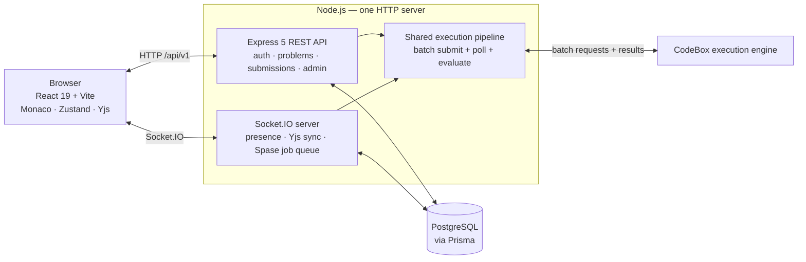
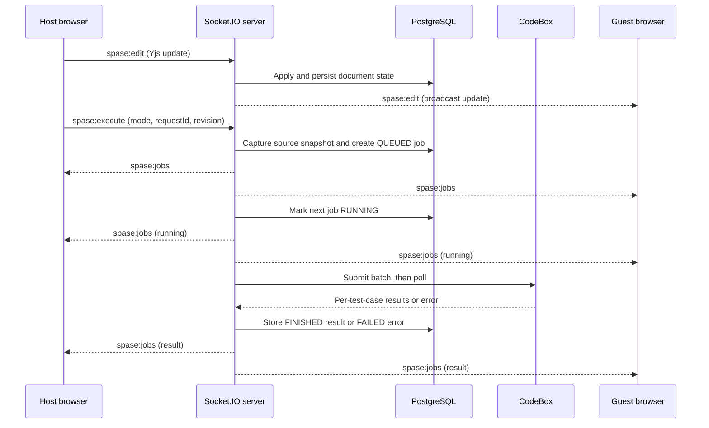
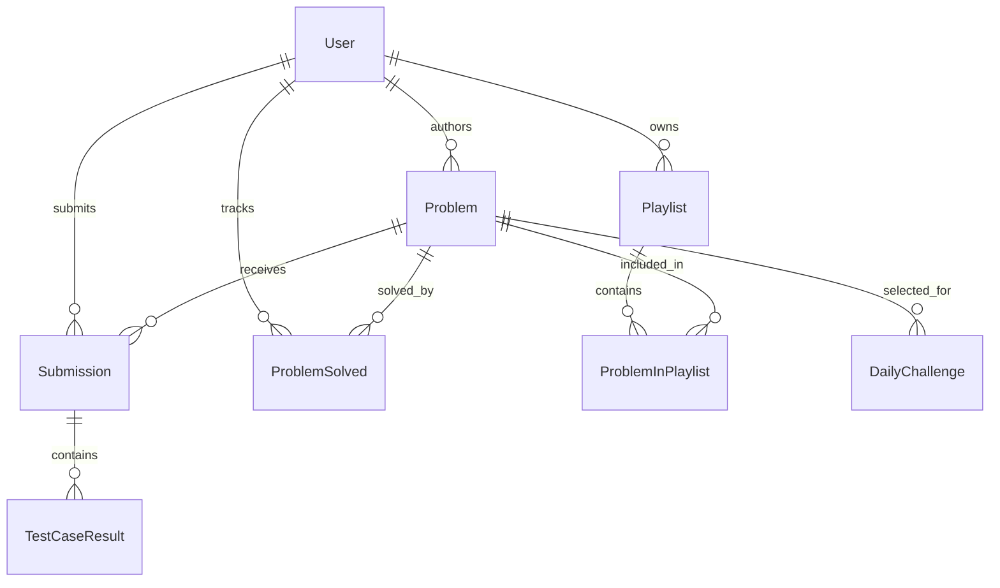
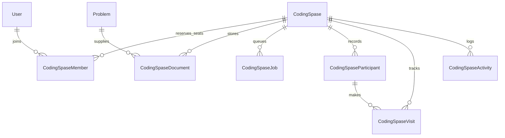

# LeetSpase

LeetSpase is a full stack platform for practicing coding problems alone or with others. It brings a problem library, code editor, judged submissions, playlists, progress tracking, and real-time collaborative **Spases** into one workspace. Users can work through a problem, test their approach, review execution errors, and revisit their solutions and progress.

Solve problems on your own, or open a **Spase**: a shared room where up to five people edit the same solution live and run it together. The host can guide a session while participants follow along as editors or viewers, with code changes, remote cursors, and execution results synchronized across their browsers.

It has two parts:

- **A practice platform:** problems, editorials, a daily challenge, submissions, playlists, and an admin dashboard.
- **Spases:** collaborative rooms with live editing, remote cursors, and a shared Run/Submit queue.

## Features

### Practice platform

- Problem library with difficulty, tags, examples, constraints, hints, intuition, editorial, walkthrough, complexity notes, and an optional video link.
- Monaco editor with Python, Java, and JavaScript.
- **Run** executes against the first three test cases, or all available cases if fewer than three; **Submit** executes against all of them.
- Per-test-case results with status, runtime, and memory when reported; submission history and solved tracking.
- Daily challenge: one problem picked per day and stored, so everyone sees the same one.
- Custom playlists.
- Email/password and Google sign-in.
- Profile page: bio, preferred language, password change, and account deletion.

### Spases (collaborative rooms)

- Create a room, share a 5-character invite code, and solve a problem together. The host selects the problem for the group.
- Host decides whether guests join as **Editors** or **Viewers**.
- Live shared editing with remote cursors and per-user colors.
- One shared Run/Submit queue, so everyone sees the same job states and results.
- Host controls support removing members, handing over the host role when leaving, and ending the Spase.
- Session history is recorded for the admin dashboard.

### Admin

- Overview, users (role and account status), submissions, and system status.
- Spase history: totals for active, inactive, and ended sessions, with detail per session.
- Create problems through a form. Before a problem is saved, its reference solutions are run against its test cases, and the request is rejected if any fail.

## Tech stack

### Frontend

- **React 19 (JavaScript):** Component-based UI for the practice workspace, profiles, Spases, and admin dashboard.
- **Vite:** Frontend development server and build tooling.
- **React Router:** Client-side navigation and protected page routing.
- **Zustand:** Client state for authentication, problems, submissions, and playlists.
- **Tailwind CSS and DaisyUI:** Styling utilities and component styles.
- **Monaco Editor:** Browser-based code editing and syntax highlighting.
- **Yjs:** Shared document state and merging concurrent edits.
- **Socket.IO Client:** Live session events, presence, cursor updates, and shared results.
- **Axios:** Requests to the backend API.
- **React Hook Form and Zod:** Form state and validation.
- **Lucide and React Icons:** Interface and language icons.

### Backend

- **Node.js:** JavaScript runtime for the API and collaboration server.
- **Express 5:** REST endpoints and authentication/authorization middleware.
- **Socket.IO:** Spase membership, document updates, presence, and execution broadcasts.
- **Yjs:** Applies shared document updates before persisting the merged state.
- **Prisma ORM:** Database queries, transactions, schema, and migrations.
- **PostgreSQL:** Users, problems, submissions, playlists, and Spase state/history.
- **CodeBox execution engine:** Batch code execution and test-case evaluation.
- **JWT and cookie-parser:** Cookie authentication and short-lived Spase connection tickets.
- **bcryptjs:** Password hashing and verification.
- **Google Auth Library:** Verification of Google sign-in credentials.
- **dotenv and CORS:** Environment configuration and allowed frontend origins.

## How it works

### Architecture



REST requests handle accounts, problems, submissions, playlists, and administration. Socket.IO carries live Spase events over the same HTTP server. Yjs merges edits, while PostgreSQL stores shared documents separately for each Spase, problem, and language.

### Running code

1. The client sends source code, language, and problem ID. Test cases are loaded on the server. In a Spase, the server captures the current shared document for the requested problem and language.
2. The server sends one batch to the **CodeBox execution engine**, which exposes a Judge0-compatible API, and polls for results with a deadline.
3. Each test case passes only if the judge reports `Accepted` **and** the trimmed output matches the expected output.
4. Submit stores a `Submission` with one `TestCaseResult` per test case and marks the problem solved if everything passed. In a Spase, the submission belongs to the user who clicked Submit, and the result is shared with everyone.

### Inside a Spase



Editors can initiate the same flow as the host; viewers receive updates and results. Jobs run one at a time within each Spase. Request IDs prevent a repeated request from creating a duplicate job, and each job uses its saved source snapshot even if the group continues editing.

## Data model

The source of truth is [`backend/prisma/schema.prisma`](backend/prisma/schema.prisma). The schema has two groups: practice data and Spase state/history.

### Practice data



| Model | Stores |
| --- | --- |
| `User` | Identity, email, username, password hash or Google ID, profile fields, role, and account status. |
| `Problem` | Statement, difficulty, tags, learning material, examples, test cases, starter code, reference solutions, and author. |
| `DailyChallenge` | A challenge date and its selected problem; the date is unique. |
| `Submission` | User, problem, source code, language, verdict, outputs, diagnostics, timing, and memory. |
| `TestCaseResult` | A submission's individual case result: pass/fail, expected and actual output, diagnostics, status, runtime, and memory. |
| `ProblemSolved` | A unique user/problem pair for solved tracking. |
| `Playlist` | A user's named collection and description; names are unique per user. |
| `ProblemInPlaylist` | The playlist/problem join record; the pair is unique. |

Problem examples, test cases, starter code, and reference solutions are JSON fields on `Problem`. `TestCaseResult` stores execution results rather than the problem's test definitions.

### Spase state and history



| Model | Stores |
| --- | --- |
| `CodingSpase` | Invite code, creator/current host/ending user references, guest mode, current problem/language, revision, start/end times, empty-state timestamps, and close reason. |
| `CodingSpaseMember` | Current membership, session ID, seat reservation expiry, removal time, and assigned color. Keyed by Spase and user. |
| `CodingSpaseDocument` | Binary Yjs state keyed by Spase, problem, and language. |
| `CodingSpaseJob` | Request ID, initiating user/name, problem/language snapshot, Run/Submit mode, source snapshot, job state, result/error, and execution timestamps. |
| `CodingSpaseParticipant` | A historical participant identity within a Spase, with an optional account reference. |
| `CodingSpaseVisit` | A participant's session, initial/current role, join/last-seen/disconnect/leave timestamps, and leave reason. |
| `CodingSpaseActivity` | Problem selections and language changes, including actor, problem title, language, event type, and timestamp. |

Spase creator, host, participant, activity actor, and job actor references can become null when an account is deleted, preserving session history. Membership reservations are separate from confirmed attendance visits. Jobs follow `QUEUED → RUNNING → FINISHED` or `FAILED`, with a unique Spase/user/request ID combination to prevent duplicates. The job's problem ID/title are snapshots rather than a foreign-key relation to `Problem`.

## Project structure

```text
LeetSpase/
├── backend/
│   ├── prisma/             Database schema and migrations
│   ├── src/
│   │   ├── controllers/    API handlers
│   │   ├── routes/         API endpoints
│   │   └── spases/         Live sessions, jobs, and history
│   └── scripts/            Data and Spase validation
└── frontend/
    └── src/
        ├── page/           App screens
        ├── components/     Shared UI
        ├── spases/         Collaborative editor and session UI
        └── store/          Client state
```

## Setup

You need Node.js 22.12 or newer, npm, PostgreSQL, and access to the CodeBox execution engine. Google OAuth is optional.

### Backend

From the repository root:

```bash
cd backend
npm ci
cp .env.example .env
```

Set `DATABASE_URL`, `JWT_SECRET`, `FRONTEND_URL`, `JUDGE0_API_URL`, and `JUDGE0_API_KEY` in `backend/.env`. The `JUDGE0_*` names configure CodeBox. The example file describes the remaining settings. On PowerShell, use `Copy-Item .env.example .env` for the copy step.

Then generate the database client, apply migrations, and start the server:

```bash
npx prisma generate
npx prisma migrate deploy
npm start
```

With the example configuration, the API starts on `http://localhost:8080`.

### Frontend

In a second terminal, from the repository root:

```bash
cd frontend
npm ci
npm run dev
```

Open `http://localhost:5173`. For Google sign-in, set `VITE_GOOGLE_CLIENT_ID` in `frontend/.env`. `VITE_SPASE_SOCKET_URL` can override the Socket.IO URL if it differs from the API host. Do not commit credentials.

## API

The Express API is mounted under `/api/v1`:

| Route | Purpose |
| --- | --- |
| `/auth` | Accounts and authentication |
| `/problems` | Library, problem details, and daily challenge |
| `/execute-code`, `/submission` | Run, submit, and review results |
| `/playlist`, `/profile` | Personal collections and progress |
| `/spases` | Spase creation and membership |
| `/admin` | Problem management and activity history |

Socket.IO handles live Spase events. `GET /health` reports backend readiness.

## Validation

```bash
cd frontend
npm run lint
npm run build

cd ../backend
npm run validate:spase-migrations
npm run validate:spases
```

The Spase validation commands require a configured local database. Additional problem-data checks are available in `backend/package.json`.
